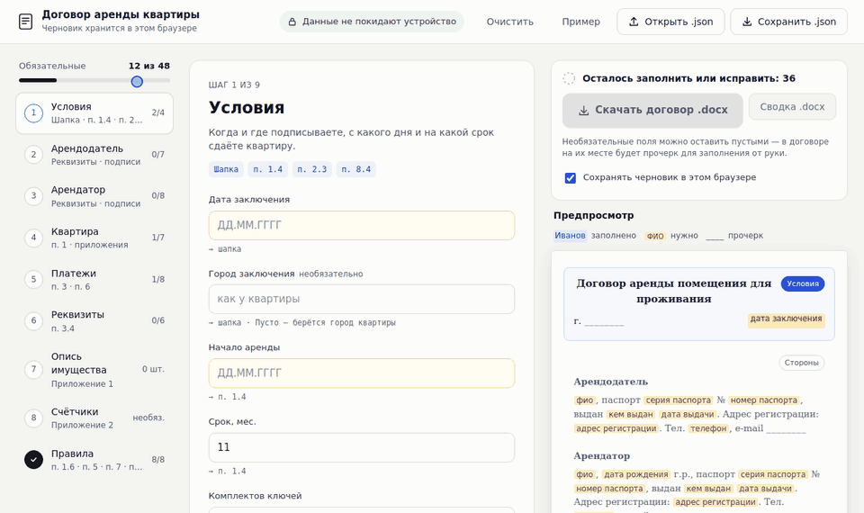

# СИСТЕМА ГЕНЕРАЦИИ ДОГОВОРОВ АРЕНДЫ

Автоматизированная система для создания договоров аренды квартиры и сводок в формате DOCX.



## БЫСТРЫЙ СТАРТ

Нужен только Python 3.8+ (дополнительные пакеты не нужны). Одна команда запускает веб-конструктор и открывает его в браузере:

| Система | Команда |
|---|---|
| Linux / macOS | `./project.sh` |
| Windows | двойной клик по `project.cmd` или `project.cmd` в консоли |
| Любая | `python run.py` (или `python3 run.py`) |

Заполните шаги слева направо — справа виден договор, подсвечено место каждого поля. Кнопка «Пример» заполняет форму вымышленными данными.
Когда обязательные поля заполнены, станет активна кнопка «Скачать договор .docx».

**Где хранятся данные.** Сервер слушает только `127.0.0.1` (этот компьютер), ничего не пишет на диск и не логирует содержимое запросов;
документ собирается в памяти и сразу отдаётся браузеру. Черновик хранится в `localStorage` этого браузера — его можно отключить галочкой
«Сохранять черновик» или стереть кнопкой «Очистить». Страница не обращается к внешним сайтам (шрифты и скрипты — локальные).
«Сохранить .json» / «Открыть .json» работают с тем же форматом, что и командная строка.

Другие команды (те же через `./project.sh …` и `project.cmd …`):

```bash
python run.py --port 8765 --no-browser   # свой порт, без автозапуска браузера
python run.py test                       # автотесты
python run.py contract --data contract_data.json   # договор из JSON без браузера
python run.py summary  --data contract_data.json   # сводка из JSON
```

## СТРУКТУРА ПРОЕКТА

```
DocOps-arenda/
├── contract_data.json          # Файл с РЕАЛЬНЫМИ персональными данными (в .gitignore)
├── contract_data.template.json # Шаблон для заполнения (отслеживается Git)
├── create_contract.py          # Скрипт генерации договора
├── create_summary.py           # Скрипт генерации сводки
├── contract_utils.py           # Проверка данных, даты, числа прописью, командная строка
├── docx_builder.py             # Сборка DOCX (абзацы, таблицы, упаковка zip)
├── run.py                      # Единая точка запуска: веб-конструктор, тесты, CLI
├── project.sh / project.cmd    # Обёртки запуска для Linux/macOS и Windows
├── webapp.py                   # Локальный веб-сервер (только 127.0.0.1)
├── web/                        # Страница конструктора: index.html, style.css, app.js
├── docs/interface.gif          # Демонстрация интерфейса для README
├── tests/                      # Автотесты (unittest)
├── requirements.txt            # Зависимостей нет (только комментарий)
├── README.md                   # Документация
├── CHANGELOG.md                # История изменений
├── .gitignore                  # Исключения для Git
├── doc/                        # Сгенерированные документы (в .gitignore)
│   ├── Договор_аренды_квартиры_v{timestamp}.docx
│   └── summary/
│       └── СВОДКА_ДОГОВОРА_v{timestamp}.docx
└── example/                    # Образцы документов и contract_data.example.json (вымышленные данные)
```

## ФАЙЛ С ДАННЫМИ: contract_data.json

Все персональные данные и параметры договора хранятся в JSON файле для удобства редактирования.

### Структура данных:

#### 1. ИНФОРМАЦИЯ О ДОГОВОРЕ
```json
"contract": {
  "conclusion_date": "18.11.2025",    // Дата заключения
  "conclusion_city": "",                // Город заключения (необязательно; пусто — город квартиры)
  "start_date": "19.11.2025",          // Дата начала аренды
  "duration_months": 11,                // Срок аренды в месяцах
  "keys_count": 1                       // Количество комплектов ключей
}
```

#### 2. ДАННЫЕ АРЕНДОДАТЕЛЯ
```json
"landlord": {
  "full_name": "Иванов Иван Иванович",
  "passport_series": "1234",
  "passport_number": "567890",
  "passport_issued_by": "ГУ МВД России по г. Москве",
  "passport_issued_date": "01.01.2010",
  "registration_address": "г. Москва, ул. Примерная, д. 1, кв. 1",
  "phone": "+7 900 123 45 67",
  "email": "landlord@example.com"
}
```

#### 3. ДАННЫЕ АРЕНДАТОРА
```json
"tenant": {
  "full_name": "Петров Петр Петрович",
  "date_of_birth": "01.01.1990",
  "passport_series": "4321",
  "passport_number": "098765",
  "passport_issued_by": "ГУ МВД России по г. Москве",
  "passport_issued_date": "15.06.2015",
  "registration_address": "г. Москва, ул. Другая, д. 5, кв. 10",
  "phone": "+7 901 234 56 78",
  "email": "tenant@example.com"
}
```

#### 4. ДАННЫЕ О ПОМЕЩЕНИИ
```json
"property": {
  "type": "Квартира",
  "address": {
    "city": "Москва",
    "street": "ул. Примерная",
    "house": "10",
    "building": "2",
    "apartment": "42",
    "floor": "5"
  },
  "cadastral_number": "77:01:0001001:1000",
  "area": "45",
  "ownership": "единоличной собственности"
}
```

#### 5. ФИНАНСОВЫЕ УСЛОВИЯ
```json
"financial": {
  "monthly_rent": 60000,
  "security_deposit": 30000,
  "payment_period_start": 18,
  "payment_period_end": 20,
  "first_payment_deadline": "20.11.2025",
  "deposit_deadline": "20.11.2025",
  "penalty_rate": 0.1,
  "sbp_phone": "+7 900 123 45 67"
}
```

#### 6. БАНКОВСКИЕ РЕКВИЗИТЫ
```json
"bank_details": {
  "recipient": "Иванов Иван Иванович",
  "account_number": "40817810100001234567",
  "payment_purpose": "Перевод средств по договору № 1234567890 Иванов Иван Иванович НДС не облагается",
  "bik": "044525225",
  "bank_name": "ПАО Сбербанк",
  "correspondent_account": "30101810400000000225",
  "inn": "1234567890",
  "kpp": "123456789"
}
```

#### 7. ОПИСЬ ИМУЩЕСТВА
```json
"inventory": [
  {"name": "Шкаф-купе IKEA с зеркалом", "serial": "", "quantity": 1, "condition": ""},
  {"name": "Микроволновая печь (оранжевая)", "serial": "MW20K-4410", "quantity": 1, "condition": "исправна"},
  {"name": "Стул", "quantity": 2},
  {"name": "Стиральная машинка Candy Smart", "serial": "WM8812345"}
]
```

Обязательно только `name`. `serial` (серийный номер) — пусто или нет поля → «—» в таблице Приложения № 1;
`quantity` — целое ≥ 1, по умолчанию 1; `condition` (состояние) — пусто → пустая ячейка для заполнения при приёмке.
Старый формат — просто строки с наименованиями — тоже принимается.

#### 8. ПОКАЗАНИЯ СЧЕТЧИКОВ
```json
"meters": {
  "electricity": {
    "number": "12345678",
    "reading": "1234.5",
    "date": "19 ноября 2025 г."
  },
  "cold_water": {
    "number": "",
    "reading": "",
    "date": "19 ноября 2025 г."
  },
  "hot_water": {
    "number": "",
    "reading": "",
    "date": "19 ноября 2025 г."
  }
}
```

Поля: `number` — заводской номер счётчика, `reading` — показания на дату передачи, `date` — дата снятия. В договоре пустые значения остаются пустыми ячейками, в сводке вместо пустых показаний выводится «(заполнить)».

#### 9. ПРАВИЛА И СРОКИ
```json
"rules": {
  "max_additional_residents": 1,
  "notification_days_for_residents": 3,
  "animals_allowed_by_default": false,
  "meters_submission_day": 15,
  "meters_submission_time": "23:00",
  "utility_payment_days": 5,
  "termination_notice_days": 30,
  "eviction_days": 7,
  "deposit_return_days": 10
}
```

## УСТАНОВКА

### Для новых пользователей:

```bash
# 1. Клонируйте репозиторий
git clone <url-репозитория>
cd arenda

# 2. Проверьте версию Python
python3 --version

# 3. (Опционально) Проверьте зависимости
cat requirements.txt
# Примечание: дополнительная установка не требуется

# 4. Создайте файл с вашими данными
cp contract_data.template.json contract_data.json

# 5. Отредактируйте файл с данными
nano contract_data.json
```

## ПЕРВОНАЧАЛЬНАЯ НАСТРОЙКА

### 1. Создание файла с данными

Скопируйте шаблон и заполните своими данными:

```bash
cp contract_data.template.json contract_data.json
nano contract_data.json
```

Замените все заглушки (`ФАМИЛИЯ ИМЯ ОТЧЕСТВО`, `DD.MM.YYYY`, `+7 XXX XXX XX XX` и т.д.) на реальные данные.

ВАЖНО: Файл `contract_data.json` с реальными данными автоматически игнорируется Git для безопасности!

## ИСПОЛЬЗОВАНИЕ

### 1. Редактирование данных

Отредактируйте файл `contract_data.json`:

```bash
nano contract_data.json
```

или откройте в любом текстовом редакторе.

### 2. Генерация договора

```bash
python3 create_contract.py
```

Будет создан файл: `doc/Договор_аренды_квартиры_v{ГГГГ-ММ-ДД}_{ЧЧ-ММ-СС}.docx`

### 3. Генерация сводки

```bash
python3 create_summary.py
```

Будет создан файл: `doc/summary/СВОДКА_ДОГОВОРА_v{ГГГГ-ММ-ДД}_{ЧЧ-ММ-СС}.docx`

Запускайте скрипты из корня проекта: по умолчанию они читают `contract_data.json` из текущей папки.

### 4. Параметры командной строки

Оба скрипта принимают:

| Параметр | Назначение |
|----------|------------|
| `--data ФАЙЛ` | файл с данными (по умолчанию `contract_data.json`) |
| `--check` | только проверить данные, ничего не создавать |
| `-o ФАЙЛ`, `--output ФАЙЛ` | путь к создаваемому файлу |

```bash
python3 create_contract.py --check
python3 create_contract.py --data example/contract_data.example.json -o /tmp/test.docx
```

### 5. Проверка данных

Перед генерацией данные проверяются: наличие полей, формат дат (`ДД.ММ.ГГГГ`), числа, длины БИК (9 цифр), ИНН (10 или 12), счетов (20), а также незаменённые заглушки шаблона. При ошибке скрипт выводит список проблемных полей и ничего не создаёт.

Необязательные поля (паспорт, адрес регистрации, телефон, email, корпус, этаж, номера и показания счётчиков, КПП) можно оставить пустыми: в документе будет линия для заполнения от руки.

Необязательные параметры (по умолчанию берутся из связанных значений):
- `contract.prolongation_months` — срок пролонгации (по умолчанию `duration_months`)
- `rules.prolongation_notice_days` — за сколько дней уведомлять о продлении (по умолчанию `termination_notice_days`)
- `rules.indexation_notice_days` — за сколько дней уведомлять об индексации (по умолчанию `termination_notice_days`)
- `rules.animals_allowed_by_default` — `true` разрешает животных (по умолчанию `false`)

### 6. Тесты

```bash
python3 -m unittest discover -s tests
```

### 7. Проверка результата

Откройте файл в Word или LibreOffice и просмотрите весь договор перед подписанием.

## ИЗВЕСТНЫЕ ОГРАНИЧЕНИЯ

- Юридический текст договора по-прежнему находится в `create_contract.py`. Менять формулировки нужно в коде.
- Некоторые значения не вынесены в JSON: 24 часа на согласование проверки (п. 4.2.3), ночные часы 23:00–07:00 (п. 5.1.11), порог просрочки «более двух раз подряд» (п. 8.3.1).
- Результат проверялся автотестами (структура и корректность XML), но визуально в Word и LibreOffice его нужно просмотреть.
- Текст договора не является юридической консультацией. Перед использованием покажите его юристу.

## ПРЕИМУЩЕСТВА СИСТЕМЫ

1. **Централизованные данные** - все данные в одном JSON файле
2. **Легкое редактирование** - изменяйте данные без редактирования кода
3. **Версионность** - каждый файл имеет дату и время создания
4. **Переиспользование** - один файл данных для договора и сводки
5. **Безопасность** - персональные данные отделены от кода

## ИЗМЕНЕНИЕ ПАРАМЕТРОВ

### Изменить арендную плату:
```json
"monthly_rent": 70000,
```

Сумма прописью, числа прописью в скобках («11 (одиннадцать) месяцев») и склонение («5 (пяти) рабочих дней») формируются автоматически. Поля `monthly_rent_text` и `security_deposit_text` больше не нужны и игнорируются.

### Изменить срок аренды:
```json
"duration_months": 12,
```

### Добавить имущество:
```json
"inventory": [
  {"name": "Шкаф-купе IKEA с зеркалом", "serial": ""},
  {"name": "Микроволновая печь (оранжевая)", "serial": "MW20K-4410"},
  {"name": "Комод IKEA черный", "serial": ""},
  {"name": "Стиральная машинка Candy Smart", "serial": "WM8812345"},
  {"name": "Холодильник Samsung", "serial": "RB37J5000SA"},
  {"name": "Диван-кровать"}
]
```

### Изменить сроки оплаты:
```json
"payment_period_start": 15,
"payment_period_end": 18,
```

### Изменить день передачи показаний счетчиков:
```json
"meters_submission_day": 20,
"meters_submission_time": "20:00",
```

## БЕЗОПАСНОСТЬ

### ЗАЩИТА ПЕРСОНАЛЬНЫХ ДАННЫХ:

1. **Файл с реальными данными** (`contract_data.json`) автоматически добавлен в `.gitignore`
2. **Шаблон** (`contract_data.template.json`) содержит только примеры и отслеживается Git
3. **Сгенерированные документы** в папке `doc/` также игнорируются Git

### РЕКОМЕНДАЦИИ:

- Никогда не коммитьте файл `contract_data.json` с реальными данными
- Создавайте резервные копии `contract_data.json` в безопасном месте
- Проверяйте данные перед генерацией документов
- При публикации в публичный репозиторий используйте только `contract_data.template.json`

### ДЛЯ РАЗРАБОТЧИКОВ:

Если вы форкаете проект:

```bash
# 1. Клонируйте репозиторий
git clone <url>

# 2. Создайте свой файл с данными из шаблона
cp contract_data.template.json contract_data.json

# 3. Заполните реальными данными (файл автоматически игнорируется)
nano contract_data.json
```

## ТРЕБОВАНИЯ

- Python 3.8+
- Стандартные библиотеки Python (json, zipfile, datetime, http.server и др.)
- Для веб-конструктора — любой современный браузер

Проект не требует установки дополнительных зависимостей через pip, так как использует только стандартные библиотеки Python.

### Проверка версии Python:

```bash
python3 --version
```

Если версия Python ниже 3.8, обновите Python до последней версии.

## ПОДДЕРЖКА

При возникновении проблем:
1. Проверьте корректность JSON синтаксиса
2. Убедитесь, что все обязательные поля заполнены
3. Проверьте кодировку файла (должна быть UTF-8)

## ВЕРСИЯ

Текущая версия: 1.0.0 (см. [CHANGELOG.md](CHANGELOG.md))
Дата обновления: 07.11.2026

